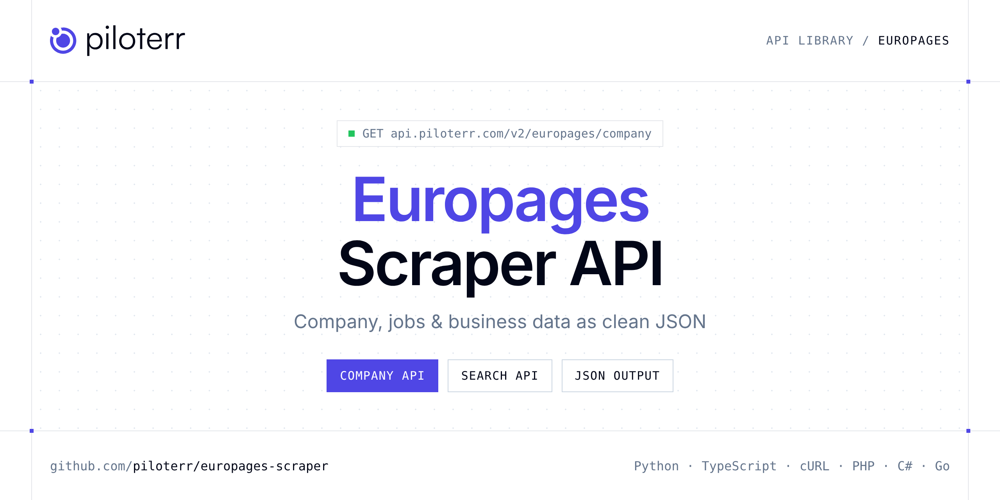

<p align="center">
  <a href="https://www.piloterr.com"></a>
</p>

# Europages Scraper API

[](https://discord.gg/CFj3ph8aHU) [](https://app.piloterr.com) [](https://app.piloterr.com/openapi) [](LICENSE)

The **Piloterr Europages Scraper API** lets you extract public data from Europages as **clean, structured JSON** — no proxies, headless browsers or HTML parsing to maintain. Endpoints available in production:

- **Europages Company API** — Europages company profile with address, supplier type and the products listed on the page (1 credit).
- **Europages Search API** — Search Europages suppliers by keyword or category URL.

Use it for lead generation, CRM enrichment, market mapping, investment research or job market analytics.

| Endpoint | Path | Credits | What you get |
|---|---|---|---|
| [Europages Company API](#europages-company-api) | `/v2/europages/company` | 1 | Europages company profile with address, supplier type and the products listed on the page (1 credit). |
| [Europages Search API](#europages-search-api) | `/v2/europages/search` | 1 | Search Europages suppliers by keyword or category URL. Returns company cards and pagination (1 credit). |

## Table of contents

- [How it works](#how-it-works)
- [Europages Company API](#europages-company-api)
- [Europages Search API](#europages-search-api)
- [Code examples in other languages](#code-examples-in-other-languages)
- [Practical use cases](#practical-use-cases)
- [Why Piloterr?](#why-piloterr)
- [FAQ](#faq)
- [Related scrapers](#related-scrapers)
- [Support](#support)

## How it works

1. **Create a free Piloterr account** and copy your API key from the [dashboard](https://app.piloterr.com).
2. **Send a `GET` (or `POST`) request** to `https://api.piloterr.com/v2/...` with the header `x-api-key: YOUR_API_KEY`.
3. **Receive structured JSON** — Piloterr handles rendering, proxies, retries and parsing.

```bash
export PILOTERR_API_KEY="your-api-key"
pip install requests        # Python
# TypeScript: Node.js 18+ (native fetch), run with `npx tsx file.ts`
```

> Every endpoint accepts both `GET` (query string) and `POST` (JSON body with the same fields).

## Europages Company API

Europages company profile with address, supplier type and the products listed on the page (1 credit).

`GET | POST https://api.piloterr.com/v2/europages/company` · **1 credit per request** · [Full reference](https://app.piloterr.com/openapi)

### Request parameters

| Parameter | Type | Required | Description |
|---|---|---|---|
| `query` | string | ✅ | Profile URL copied from a search card, or a slug. |
| `domain` | string | — | Site when query is a slug. Same values as search. Default fr. Ignored when query is a URL. |

### Python example

```python
import json
import os
import requests

response = requests.get(
    "https://api.piloterr.com/v2/europages/company",
    headers={"x-api-key": os.environ["PILOTERR_API_KEY"]},
    params={
        "query": "https://www.europages.fr/fr/company/synyco-sas-22106635",
    },
    timeout=120,
)
response.raise_for_status()
data = response.json()

print(json.dumps(data, indent=2, ensure_ascii=False)[:2000])
```

### TypeScript example

```typescript
type EuropagesCompany = {
  url?: string;
  name?: string;
  address?: {
    city?: string;
    street?: string;
    formatted?: string;
    postal_code?: string;
  };
  country?: string;
  website?: string;
  products?: {
    url?: string;
    name?: string;
    price?: number;
    currency?: string;
    price_display?: string;
    minimum_order_quantity?: string;
  }[];
  categories?: string[];
  company_id?: string;
  description?: string;
  delivery_area?: string;
  supplier_types?: string[];
};

const params = new URLSearchParams({
  "query": "https://www.europages.fr/fr/company/synyco-sas-22106635",
});

const response = await fetch(`https://api.piloterr.com/v2/europages/company?${params}`, {
  headers: { "x-api-key": process.env.PILOTERR_API_KEY! },
});
if (!response.ok) throw new Error(`Piloterr error ${response.status}: ${await response.text()}`);

const data = (await response.json()) as EuropagesCompany;

console.log(JSON.stringify(data, null, 2).slice(0, 2000));
```

<details>
<summary><b>POST variant</b></summary>

```http
POST https://api.piloterr.com/v2/europages/company
x-api-key: YOUR_API_KEY
Content-Type: application/json

{"query": "https://www.europages.fr/fr/company/synyco-sas-22106635"}
```
</details>

### Output example

Example response from the API reference, abridged — real values depend on the page you scrape.

```json
{
  "url": "https://www.europages.fr/fr/company/synyco-sas-22106635",
  "name": "SYNYCO SAS",
  "address": {
    "city": "Hautmont",
    "street": "64 Avenue General Leclerc",
    "formatted": "64 Avenue General Leclerc, Hautmont 59330",
    "postal_code": "59330"
  },
  "country": "France",
  "website": "http://www.synyco.com",
  "products": [
    {
      "url": "https://www.europages.fr/fr/company/synyco-sas-22106635/products/mix-electromenager-appareils-electromenagers-mixtes-35944406",
      "name": "Mix électroménager / appareils électroménagers mixtes",
      "price": 500,
      "currency": "EUR",
      "price_display": "500,00 €",
      "minimum_order_quantity": "2 palettes"
    },
    {
      "url": "https://www.europages.fr/fr/company/synyco-sas-22106635/products/tissu-destockage-pour-meuble-et-rideaux-stocklot-fabrics-for-furniture-m…",
      "name": "Tissu destockage pour meuble et rideaux / stocklot fabrics for furniture made in EU",
      "price": 1.5,
      "currency": "EUR",
      "price_display": "1,50 €",
      "minimum_order_quantity": "6000 m"
    }
  ],
  "categories": [
    "Appareils ménagers (Autre)",
    "Produits cosmétiques (Autre)"
  ],
  "company_id": "22106635",
  "description": "Synyco Sas, une entreprise spécialisée dans les surplus et les produits finis pour le marché local, toute l'Europe, l'Afrique, l'Amérique…",
  "delivery_area": "Mondiale",
  "supplier_types": [
    "Prestataire de services",
    "Grossiste"
  ]
}
```

### Response fields

| Field | Type | Description |
|---|---|---|
| `url` | string |  |
| `name` | string |  |
| `address` | object |  |
| `address.city` | string |  |
| `address.street` | string |  |
| `address.formatted` | string |  |
| `address.postal_code` | string |  |
| `country` | string |  |
| `website` | string |  |
| `products[]` | object[] |  |
| `products[].url` | string |  |
| `products[].name` | string |  |
| `products[].price` | integer |  |
| `products[].currency` | string |  |
| `products[].price_display` | string |  |
| `products[].minimum_order_quantity` | string |  |
| `categories` | string[] |  |
| `company_id` | string |  |
| `description` | string |  |
| `delivery_area` | string |  |
| `supplier_types` | string[] |  |

## Europages Search API

Search Europages suppliers by keyword or category URL. Returns company cards and pagination (1 credit).

`GET | POST https://api.piloterr.com/v2/europages/search` · **1 credit per request** · [Full reference](https://app.piloterr.com/openapi)

### Request parameters

| Parameter | Type | Required | Description |
|---|---|---|---|
| `query` | string | ✅ | Keyword, or a category / search URL on Europages. |
| `domain` | string | — | Site of a keyword: fr (default), de, co.uk (en, uk, gb), es, it, nl, and the other Europages TLDs. Ignored when query is a URL. German uses /suche/. |
| `page` | number | — | Page from 1. Page 2 and after use /pg-N/. 30 companies per page. |

### Python example

```python
import json
import os
import requests

response = requests.get(
    "https://api.piloterr.com/v2/europages/search",
    headers={"x-api-key": os.environ["PILOTERR_API_KEY"]},
    params={
        "query": "emballage",
    },
    timeout=120,
)
response.raise_for_status()
data = response.json()

print(json.dumps(data, indent=2, ensure_ascii=False)[:2000])
```

### TypeScript example

```typescript
type EuropagesSearch = {
  results?: {
    url?: string;
    city?: string;
    name?: string;
    country?: string;
    position?: number;
    employees?: string;
    company_id?: string;
    description?: string;
    delivery_area?: string;
    founding_year?: unknown;
    supplier_types?: string[];
  }[];
  pagination?: {
    next?: string;
    page?: number;
    per_page?: number;
    total_pages?: number;
    total_results?: number;
  };
};

const params = new URLSearchParams({
  "query": "emballage",
});

const response = await fetch(`https://api.piloterr.com/v2/europages/search?${params}`, {
  headers: { "x-api-key": process.env.PILOTERR_API_KEY! },
});
if (!response.ok) throw new Error(`Piloterr error ${response.status}: ${await response.text()}`);

const data = (await response.json()) as EuropagesSearch;

console.log(JSON.stringify(data, null, 2).slice(0, 2000));
```

<details>
<summary><b>POST variant</b></summary>

```http
POST https://api.piloterr.com/v2/europages/search
x-api-key: YOUR_API_KEY
Content-Type: application/json

{"query": "emballage"}
```
</details>

### Output example

Example response from the API reference, abridged — real values depend on the page you scrape.

```json
{
  "results": [
    {
      "url": "https://www.europages.fr/ALYA-PACKAGING/00000005424124-761159001.html",
      "city": "Istanbul",
      "name": "ALYA PACKAGING",
      "country": "Turquie",
      "position": 1,
      "employees": "50-99",
      "company_id": "5424124",
      "description": "Alya Packaging, située à Istanbul, met plus de 30 ans d'expertise au service de solutions d' emballage imprimées sur mesure. Nos capacité…",
      "delivery_area": "Mondiale",
      "founding_year": null,
      "supplier_types": [
        "Fabricant/Producteur"
      ]
    }
  ],
  "pagination": {
    "next": "https://www.europages.fr/entreprises/pg-2/emballage.html",
    "page": 1,
    "per_page": 30,
    "total_pages": 2327,
    "total_results": 69799
  }
}
```

### Response fields

| Field | Type | Description |
|---|---|---|
| `results[]` | object[] |  |
| `results[].url` | string |  |
| `results[].city` | string |  |
| `results[].name` | string |  |
| `results[].country` | string |  |
| `results[].position` | integer |  |
| `results[].employees` | string |  |
| `results[].company_id` | string |  |
| `results[].description` | string |  |
| `results[].delivery_area` | string |  |
| `results[].founding_year` | object |  |
| `results[].supplier_types` | string[] |  |
| `pagination` | object |  |
| `pagination.next` | string |  |
| `pagination.page` | integer |  |
| `pagination.per_page` | integer |  |
| `pagination.total_pages` | integer |  |
| `pagination.total_results` | integer |  |

## Code examples in other languages

Ready-to-run examples live in the [`examples/`](examples) folder. Each one reads your key from the `PILOTERR_API_KEY` environment variable.

| Language | Company | Search |
|---|---|---|
| cURL (Bash) | [`company`](examples/curl/company.sh) | [`search`](examples/curl/search.sh) |
| PHP | [`company`](examples/php/company.php) | [`search`](examples/php/search.php) |
| C# | [`company`](examples/csharp/Company.cs) | [`search`](examples/csharp/Search.cs) |
| Go | [`company`](examples/go/company.go) | [`search`](examples/go/search.go) |
| Java | [`company`](examples/java/CompanyExample.java) | [`search`](examples/java/SearchExample.java) |
| Ruby | [`company`](examples/ruby/company.rb) | [`search`](examples/ruby/search.rb) |
| Node.js | [`company`](examples/nodejs/company.mjs) | [`search`](examples/nodejs/search.mjs) |

## Practical use cases

- **Lead generation** — Build target account lists from public company data.
- **CRM enrichment** — Keep firmographics, websites and descriptions up to date.
- **Market mapping** — Map competitors and segments across countries and industries.
- **Investment research** — Screen companies, funding and signals for deal flow.
- **Job market analytics** — Track hiring, roles and salaries where available.

## Why Piloterr?

- **No infrastructure** — no proxies, headless browsers or CAPTCHA solving to run yourself.
- **Structured JSON** — stable, documented fields instead of brittle HTML selectors.
- **Pay per request** — transparent credit cost per endpoint, failed requests are retried for you.
- **One API key, hundreds of sources** — Europages plus many other e-commerce, search and company data endpoints in the [Piloterr library](https://www.piloterr.com/library).
- **Any language** — plain HTTPS + JSON, with examples for Python, TypeScript, cURL, PHP, C#, Go, Java, Ruby and Node.js.

## FAQ

### Is it legal to scrape Europages?

Collecting publicly available data is generally allowed in many jurisdictions, but rules depend on your country, the data you collect and how you use it. Avoid personal data unless you have a lawful basis, respect the website's terms where they apply, and get legal advice for your specific use case. This is not legal advice.

### Do I need proxies or a headless browser?

No. Piloterr handles rendering, proxy rotation and retries on its side. You only send an HTTPS request with your `x-api-key` header and receive JSON.

### How much does a request cost?

Credits per call: `/v2/europages/company` **1**, `/v2/europages/search` **1**. See the [Piloterr website](https://www.piloterr.com) for plans.

### What data does the Europages API return?

Each endpoint returns structured JSON: **Europages Company** — `url`, `name`, `address`, `address.city`, `address.street`, `address.formatted`; **Europages Search** — `results[]`, `results[].url`, `results[].city`, `results[].name`, `results[].country`, `results[].position`.

### How do I paginate Europages results?

Use the `page` parameter and keep requesting while the response indicates more results.

### Can I target a specific country or language?

Yes, use `domain` — see the parameter tables above for accepted values.

### Which languages are supported?

Any language that can make an HTTP request. This README shows Python and TypeScript; the [`examples/`](examples) folder contains cURL, PHP, C#, Go, Java, Ruby and Node.js.

## Related scrapers

- [Company Database Scraper API](https://github.com/piloterr/company-data-api)
- [Crunchbase Scraper API](https://github.com/piloterr/crunchbase-scraper)
- [Fiverr Scraper API](https://github.com/piloterr/fiverr-scraper)
- [G2 Scraper API](https://github.com/piloterr/g2-scraper)
- [GitHub Scraper API](https://github.com/piloterr/github-scraper)
- [Glassdoor Scraper API](https://github.com/piloterr/glassdoor-scraper)
- [All Piloterr scrapers on GitHub](https://github.com/piloterr)

## Support

- 💬 Join the [Piloterr Discord](https://discord.gg/CFj3ph8aHU) to ask questions and share what you build.
- 📚 Browse the [API reference (OpenAPI)](https://app.piloterr.com/openapi) and the [Piloterr library](https://www.piloterr.com/library).
- 🔑 [Get your API key](https://app.piloterr.com).

---

<p align="center">
  <a href="https://www.piloterr.com">
    <picture>
      <source media="(prefers-color-scheme: dark)" srcset="images/logo-dark.svg">
      
    </picture>
  </a>
  <br>
  <sub>Built by <a href="https://www.piloterr.com">Piloterr</a> — web scraping APIs for e-commerce, search, real estate and more, one API key.</sub>
</p>

<sub>Europages is a trademark of its respective owner. This repository is not affiliated with or endorsed by Europages. Examples are released under the MIT license.</sub>
